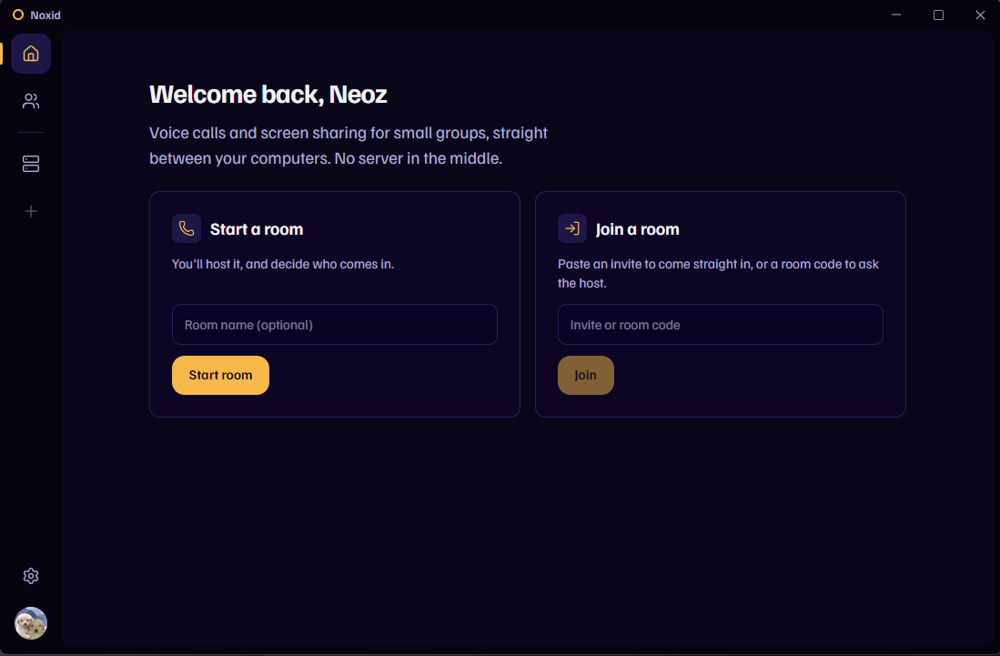
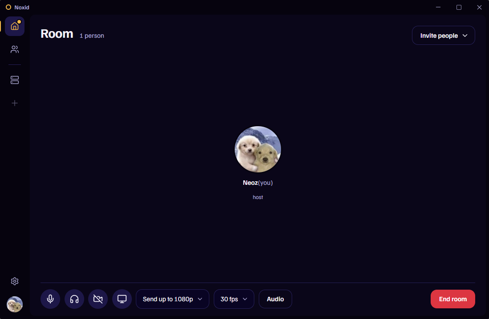

# Noxid

Voice calls and screen sharing for small groups, connecting participants
directly to each other over [iroh](https://github.com/n0-computer/iroh).



A call is voice first: you can join and only talk. Anyone can share a screen
mid-call, and everyone else sees it. Media runs on
[iroh-live](https://github.com/n0-computer/iroh-live) (Media over QUIC), with
no server in the middle.

Built for up to about six people. Every participant sends to every other one,
so upload bandwidth is what limits the size of a call.



## Install

**Windows** (per user, no Administrator prompt). In PowerShell:

```powershell
irm https://raw.githubusercontent.com/neozmmv/noxid/master/scripts/install.ps1 | iex
```

Then search for "Noxid" in the Start menu.

**Linux** (x86_64):

```sh
curl -fsSL https://raw.githubusercontent.com/neozmmv/noxid/master/scripts/install.sh | sh
```

On Debian and Ubuntu this installs the `.deb` through apt, and on Fedora the
`.rpm` through dnf. Elsewhere it installs the AppImage under `~/.local` and
adds a menu entry.

The prebuilt packages need glibc 2.39 or newer: Ubuntu 24.04, Debian 13,
Fedora 40, a current Arch, or later. On older systems, build with `--local`.

Both scripts take `--version`/`-Version` to pick a release, `--local`/`-Local`
to build from a checkout, and `--uninstall`/`-Uninstall`.

## Using it

- **Start a room** to host one. As the host you decide who comes in.
- Click **Invite people** to share either:
  - the **room code**, which anyone can use to ask to join, and you let them
    in or turn them away; or
  - an **invite**, which lets one person straight in, once, within 30
    minutes.
- **Join a room** takes either kind of code.
- When the host leaves, the room ends for everyone.

## Build from source

You need Rust 1.91 or newer and [Bun](https://bun.sh) 1.4 or newer. The
frontend is Svelte 5 in TypeScript.

Linux build dependencies (Debian and Ubuntu):

```sh
sudo apt install libasound2-dev libpipewire-0.3-dev libjack-jackd2-dev libspa-0.2-dev \
  libclang-dev nasm libwebkit2gtk-4.1-dev libayatana-appindicator3-dev librsvg2-dev \
  libxdo-dev libssl-dev build-essential
```

Windows needs the MSVC build tools and [NASM](https://www.nasm.us/) on `PATH`.

```sh
cd app
bun install
bun run tauri dev      # run the app
bun run check          # type-check the frontend
bun run tauri build    # build installers into target/release/bundle
```

## Layout

| Path | What it is |
|---|---|
| `crates/noxid-core` | Identity, rooms and invites, the mesh, media. No UI |
| `crates/noxid-cli` | A development harness that drives the core from a terminal |
| `app` | The Tauri app: Rust shell in `src-tauri`, Svelte frontend in `src` |
| `scripts` | Install scripts |

To run several nodes on one machine, give each its own state directory with
`NOXID_HOME`:

```sh
NOXID_HOME=/tmp/a cargo run -p noxid-cli -- call --name a --test-mic
```

Type `help` in it for the commands.

## Releases

Pushing a tag of the form `vX.Y.Z` (for example `v0.1.0`) builds the Windows
installer, the `.deb`, the `.rpm` and the AppImage, and publishes them as a
GitHub release named "Noxid vX.Y.Z", each with a `.sha256` file. The install scripts check that
hash before installing anything.

Clippy, the tests and the frontend type check run as part of that workflow,
before anything is built. If any of them fails, no release is published. They
do not run on ordinary pushes; run them locally before tagging:

```sh
cargo clippy --workspace --all-targets -- -D warnings
cargo test --workspace
(cd app && bun run check)
```
